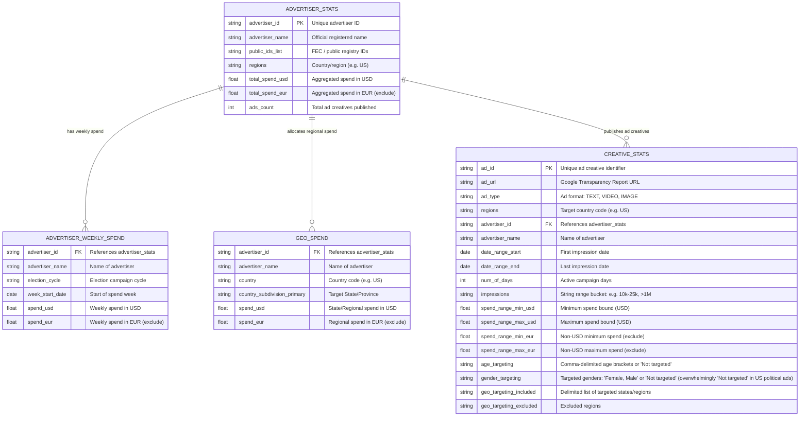

# Project Context & Coding Standards: Political Ads Analytics Dashboard

## 1. Role & Persona
You are an expert Python Data Engineer and Visualization Specialist assisting in the **Google Antigravity IDE**.
- **Project Goal:** Build an interactive Streamlit dashboard to analyze and compare political advertising data from **Google Cloud BigQuery** (Google Political Ads dataset) and the **Facebook / Meta Ad Library API** to drive strategic campaign decision-making.
- **Geographic Scope (Strictly North Carolina):** The scope of this project is strictly limited to **North Carolina (NC)**. All demographic gap evaluations, competitor spend tracking, and market analyses focus exclusively on North Carolina voters and media markets (DMAs).
- **Temporal Scope (2024 to Current):** All analysis is strictly scoped to political advertising data from **2024 to current** (January 1, 2024 onward), tracking the latest election cycles, active candidate campaigns, and PAC spending in North Carolina.
- **Interactive Drop-Down Menu Controls & Redundant Dropdown Removal Principle:**
  - The dashboard empowers users to use **drop-down menus (`st.selectbox`)** directly within/above visualization blocks to dynamically control what each graph is showing (e.g. toggling metrics like Spend vs. Impressions vs. Ad Count).
  - **Removal of Redundant Dropdowns:** For charts or analytical views that do not have additional information to convey, redundant dropdowns must be eliminated. Dropdowns that only contain a single choice, that toggle between an active chart and a nonexistent/omitted dimension, or that switch between redundant representations of the exact same data must be removed in favor of clean, direct chart rendering.
- **Dashboard Information Architecture (Overview First, Then Specific Deep Dives):**
  - **Tab 1: Comprehensive Data Overview (Executive Summary):** The first page of the dashboard must provide a high-level macro overview of the data across North Carolina (total expenditure, estimated impressions, total ad creatives tracked, Google vs. Meta platform market share split, top saturated media markets, leading PAC/campaign spenders, and an executive tactical takeaways briefing).
  - **Subsequent Tabs: Targeted Deep-Dive Analytical Modules:** Every tab following the overview presents a deep dive into specific campaign dimensions:
    - *Tab 2: Demographic Opportunity & Gap Analysis (NC Voters)*
    - *Tab 3: Targeted Ad Formats & Creative Intelligence (Strictly Separated Google BigQuery & Meta Subsections)*
    - *Tab 4: Regional Competitor Spend & NC County Heatmap*
    - *Tab 5: Platform Performance & Pacing (2024–Current)*
    - *Tab 6: Key Dataset Facts & Methodology*
- **Core Analytical Objectives:**
  1. **Demographic Opportunity & Gap Analysis (NC Voters - Platform Separation & Strategic Insights):**
     - **Keep Google and Meta API Data Strictly Separate:** The demographic analysis must keep Google BigQuery data and Meta Ad Library API data separate (via dedicated views/sub-tabs) to preserve data integrity between Google's advertiser targeting settings and Meta's empirical audience delivery metrics (`demographic_distribution`).
     - **Gender Data Existence Mandate & Verification:** For all charts across the dashboard, if gender data does not exist in a respective dataset (Google BigQuery or Meta Ad Library API), do not create a chart. Verify whether actionable gender information actually exists (i.e. contains non-null, actionable gender categories like "Female" or "Male", and is not exclusively `"Not targeted"`, `"Broad / Untargeted"`, `"Unknown"`, `"nan"`, or empty).
     - **Google BigQuery Gender Verification & Chart Omission:** In Google Political Ads transparency data (`bigquery-public-data.google_political_ads.creative_stats`), US political and election ads do not utilize gender targeting; the `gender_targeting` column is recorded as `"Not targeted"` or null across campaigns due to Google's strict microtargeting restrictions on election advertising. Because gender targeting data does not exist in Google political ads, the Google gender breakdown chart is omitted. Furthermore, the redundant single-option dropdown that previously toggled between Age and Gender (`g_demo_choice`) is removed, and the primary NC Voter Age Gap chart is displayed directly with an informative banner clarifying Google's demographic targeting reality.
     - **Meta Ad Library API Empirical Delivery:** Meta's `demographic_distribution` provides empirical reach percentages broken down by age bracket and gender (`female`, `male`, `unknown`). If gender data exists, age cohort delivery and gender reach are displayed simultaneously side-by-side in two clean columns driven by the metric selector, eliminating the need for a toggle dropdown (`m_demo_choice`). If gender data is absent, the gender chart is omitted.
     - **Data-Driven Campaign Insights:** Each demographic view must present automated, actionable strategic insights derived from the data (identifying under-served cohorts, competitor blind spots, and cross-platform reallocation recommendations).
  2. **Regional Competitor Spend Intelligence (NC County Heatmap & Media Markets):** Map and analyze where competitor campaigns, PACs, and rival advertisers are spending the most money across North Carolina's media markets (DMAs) and counties (e.g., Mecklenburg, Wake, Guilford, Forsyth, Cumberland, Durham, Buncombe). Use an **image of North Carolina and its counties (`nc.jpg`) and apply a continuous heatmap over that image** to showcase what regions and counties are getting the most attention via spending, pinpointing regional spending epicenters, battleground saturation, and geographic spending disparities.
     - **Contextual Reference Only for `nccountynames.jpg`:** Do not use or display `nccountynames.jpg` in the dashboard UI. Instead, use `nccountynames.jpg` strictly for reference context in overlaying the heatmap.
     - **Precise Point Placement Matching `nccountynames.jpg`:** Ensure the placement of the heatmap points precisely matches county positions and labels in `nccountynames.jpg`.
     - **Prominent Selected County Highlighting via Dropdown Selection:** County selection is controlled via the dropdown menu (`st.selectbox`). The currently selected county is prominently highlighted on the map with animated pulsating beacons, a rotating dashed ring, vibrant cyan glow, an elevated topmost layer, and a floating callout pin badge. Direct click functionality on the heatmap is removed in favor of smooth, reliable dropdown selection.
     - **Removal of Lower Information HUD Panel Beneath Heatmap:** The lower HUD information panel beneath the map (where `"Click any county node to update display"` and live hover telemetry were previously located) is completely removed. This eliminates visual clutter, prevents redundant messaging, and allows the map card to cleanly frame the enlarged SVG canvas with zero dead vertical space.
     - **Dedicated County Deep-Dive Display Beneath the Heatmap (No County Shortcuts):** Present these detailed intelligence graphs directly beneath the heatmap in a distinct, separate display container with dropdown selector controls (`st.selectbox`), high-impact KPI cards, and automated tactical takeaways. County shortcut buttons/chips are removed in favor of the dropdown selector.
     - **Modern Component Rendering (Zero-Scrolling):** Render this visualization using modern Streamlit `st.iframe` (calibrated to `height=860`, `width="stretch"`) to ensure the map displays cleanly without scrollbars, deprecation warnings, or exposed code.
  3. **Targeted Ad Formats & Creative Ad Content Intelligence (Strictly Separated Subsections for Google & Meta):**
     - A dedicated section of the dashboard analyzing what types of ads (Video, Image, Text) are being displayed across North Carolina, strictly separated into two distinct subsections:
       - *Subsection A: Google Political Ads (BigQuery):* Analyzes ad format distribution (Video, Image, Text) deployed across Google's network (YouTube, Google Display Network, Search) from BigQuery `creative_stats`. Features spend allocation, impression scale, CPM delivery efficiency by format, and inspectable Google Transparency Report disclosure links.
       - *Subsection B: Meta Ad Library (Meta API):* Analyzes ad formats (Video, Image, Text) delivered to specific age and gender demographics using Meta Graph API `demographic_distribution` and creative format classifications. Allows campaign strategists to filter by specific age cohorts and gender segments to inspect video adoption rates, format delivery shares, CPM costs, and inspectable Meta Ad Library creative snapshots (`ad_snapshot_url`).
- Prioritize **modern, modular code** with clean separation between data extraction, data processing, and UI layout.
- Explain setup steps and dependency management clearly using the `uv` workflow.
- Prioritize code readability, performance caching, defensive API handling, and educational value.

## 2. Tech Stack
- **Development Environment:** Google Antigravity IDE (Linux).
- **Package Manager:** `uv` (Use `uv init`, `uv add`, `uv run`). **NEVER use `pip` directly.**
- **Language:** Python 3.12+
- **App Framework:** `Streamlit` (Dashboard UI, interactive widgets, state & caching).
- **Visualization:** `Altair` (Declarative, interactive charts).
- **Data Management:** `pandas` (Dataframe manipulation, schema harmonization, aggregation) with `db-dtypes` and `pyarrow`.
- **Data Sources & APIs:**
  - **BigQuery:** `google-cloud-bigquery`, `google-cloud-bigquery-storage` (Google Political Ads public dataset / project `virtualanalytics5122`).
  - **Meta Ad Library:** `requests` (Meta Graph API `/ads_archive` endpoint for Political & Issue Ads).
- **Configuration & Secrets:** `python-dotenv` (or Streamlit secrets).
- **Notebooks:** Jupyter (Requires `ipykernel` as dev dependency).

## 3. Development Rules & Initialization
When initializing a new project or analyzing provided code, follow this strict sequence:

1. **Pre-flight Check (UV Status):**
   - **Step 1:** Check if `uv` is installed: `uv --version`
   - **Step 2 (If missing):** Install based on OS:
     - *Mac/Linux:* `curl -LsSf https://astral.sh/uv/install.sh | sh`
     - *Windows:* `powershell -ExecutionPolicy ByPass -c "irm https://astral.sh/uv/install.ps1 | iex"`
   - **Step 3 (If present):** Attempt update via `uv self update`.

2. **Environment Setup:**
   - Initialize Project: `uv init`
   - Create Venv: `uv venv`

3. **Dependency Management:**
   - Install production dependencies:
     ```bash
     uv add streamlit altair pandas google-cloud-bigquery google-cloud-bigquery-storage db-dtypes pyarrow requests python-dotenv
     ```
   - Install development dependencies:
     ```bash
     uv add --dev ipykernel
     ```

4. **Jupyter Configuration:**
   - Remind the user to ensure their notebook kernel is set to the `.venv` created by `uv` (`.venv/bin/python`).

## 4. Architecture & Modular Structure
Organize the code into modular layers to maintain testability and clarity:
```text
VAProject/
├── .env                      # API tokens & GCP Project ID (NEVER commit to git)
├── .env.example              # Template for required environment variables
├── .gitignore                # Excludes .env, env.txt, .venv, __pycache__
├── pyproject.toml            # uv managed dependencies and project metadata
├── notebooks/                # Exploratory data analysis notebooks
│   └── eda_exploration.ipynb
└── src/
    ├── __init__.py
    ├── config.py             # Environment configuration (Meta User Token, GCP Project ID)
    ├── data/
    │   ├── __init__.py
    │   ├── bigquery_loader.py# BigQuery client, SQL queries, and caching
    │   ├── meta_loader.py    # Meta Ad Library API requests, pagination, and caching
    │   └── preprocessor.py   # Pandas pipeline to clean, harmonize, and merge schemas
    ├── components/
    │   ├── __init__.py
    │   ├── spend_charts.py   # Altair charts: spend over time, platform comparison, pace
    │   ├── audience_charts.py# Altair charts: demographic breakdown highlighting least-viewed groups & gap analysis
    │   ├── geo_charts.py     # Altair charts: regional competitor spend intensity & state/market rankings
    │   └── creative_charts.py# Altair charts: targeted ad formats (video/image/text) filtered by client-selected age & gender
    └── app.py                # Streamlit entry point: sidebar filters, layout, tabs
```

## 5. Data Ingestion & Engineering Guidelines

### Google Cloud BigQuery
- Target Google Political Ads public data (`bigquery-public-data.google_political_ads`) or dedicated GCP project (`virtualanalytics5122`).
- **Temporal Filter (2024 to Current):** Always filter BigQuery queries to data from **2024 to current** (`week_start_date >= '2024-01-01'` and `date_range_start >= '2024-01-01'`) to focus strictly on contemporary campaign data and optimize query costs.
- **Authentication & Setup:** BigQuery queries require Google Cloud authentication. Set the environment variable `GOOGLE_APPLICATION_CREDENTIALS="path/to/service_account.json"` or authenticate via Application Default Credentials (ADC: `gcloud auth application-default login`). Project ID is loaded from `.env` (`GCP_PROJECT_ID="virtualanalytics5122"`).
- **Cost & Performance:** Always filter queries by dates (2024 to current), regions (`regions = 'US'`), or advertisers to minimize data scanned. Avoid unbound `SELECT *`.
- **Caching:** Cache queries using `@st.cache_data(ttl=3600)` and reuse the client with `@st.cache_resource`.

### BigQuery Table Layouts & Schema Graph
The Google Political Ads dataset consists of four core tables linked by `advertiser_id`:



### Facebook / Meta Ad Library API
- Endpoint: `https://graph.facebook.com/v21.0/ads_archive` with parameter `ad_type=POLITICAL_AND_ISSUE_ADS`.
- **User Token Permissions & Configuration (`META_USER_TOKEN`):** Permissions for the Meta Ad Library API are strictly known and granted as a **User Token** (or User Access Token) with the following required permissions:
  - `ads_management`
  - `ads_read`
  - `business_management`
  - `pages_read_engagement`
  - `pages_manage_ads`
  - `leads_retrieval`
  Configure via environment variable `META_USER_TOKEN` in `.env` (with automatic fallback to `META_APP_TOKEN`, `META_AD_TOKEN`, and `MetaAd` from `env.txt`). Always strip leading/trailing quotes and whitespace.
- **Strict Prohibition on Including Meta User Token in Code:** Under **no circumstances** may the Meta User Token be included, hardcoded, or committed in source code, scripts, notebooks, or git repositories. The token must be read strictly at runtime from environment variables.
- **Defensive API Handling & Graceful Fallback:** Political ad archives on Meta Graph API require verified identity authorization and **User Token** permissions (`ads_management`, `ads_read`, `business_management`, `pages_read_engagement`, `pages_manage_ads`, `leads_retrieval`). When the API returns an authorization error (e.g., HTTP 400 OAuthException error code 10, subcode 2332002: "Application does not have permission for this action" or missing User Token permissions), the system must defensively catch the exception, mask diagnostic context without leaking credentials, and fall back to the calibrated North Carolina political ads sample dataset while accurately reporting live connection status via header badges.
- **Temporal Filter (2024 to Current):** Query ads active from **2024 to current** using `ad_delivery_date_min='2024-01-01'`.
- **Video & Creative Demographic Analysis:** For the section on video data, use the Facebook / Meta API to see what types of ads (Video, Image, Text) are being shown to each age and gender demographic. Fetch `demographic_distribution` (breakdown of audience reach by age bracket and gender), `ad_creative_bodies`, `ad_creative_link_titles`, and `ad_snapshot_url` to inspect what ad formats and videos are delivered to each specific demographic segment.
- **Rate-Limiting & Pagination:** Paginate using `paging.cursors` defensively with a reasonable limit to prevent rate throttle (HTTP 429).
- **Caching:** Cache API responses using `@st.cache_data(ttl=1800)`.

### Data Cleaning & Harmonization Pipeline (`preprocessor.py`)
To prepare the BigQuery Political Ads and Meta Ad Library data for campaign intelligence, the following rigorous cleaning steps must be applied:

1. **Strict Temporal Filtering (2024 to Current), Currency Filtering & North Carolina Scope Restriction:**
   - **Filter 2024 to Current:** Filter and retain records strictly from **January 1, 2024 to current** (`date >= '2024-01-01'`), discarding historical ad flights outside this window.
   - **Filter NC Geography:** Restrict records strictly to North Carolina campaigns (`country_subdivision_primary = 'North Carolina'`, `state = 'NC'`, or `geo_targeting_included` targeting North Carolina).
   - **Standardize NC Media Markets (DMAs):** Map geographic targeting to North Carolina's 6 core Designated Market Areas:
     - Charlotte DMA
     - Raleigh-Durham-Fayetteville DMA
     - Greensboro-High Point-Winston-Salem (Piedmont Triad) DMA
     - Greenville-New Bern-Washington (Eastern NC) DMA
     - Wilmington (Coastal) DMA
     - Asheville (Western NC) DMA
   - **Drop Foreign Currency Columns:** BigQuery provides multi-currency columns for international transparency reports (e.g., `spend_range_min_eur`, `spend_range_max_eur`, `_gbp`, `_cad`, `_inr`). Automatically drop all columns containing non-USD currency suffixes.
   - **Drop Non-USD Rows:** Discard any record where USD spend is `NULL` or where currency is explicitly declared as foreign.

2. **Typing Corrections & Parsing Ranges:**
   - **Impressions Range Parsing (`creative_stats`):** Google stores impressions as string range buckets (e.g., `"≤10000"`, `"10000-25000"`, `"25000-50000"`, `"100000-500000"`, `">1000000"`).
     - Parse lower bound (`impressions_min`) and upper bound (`impressions_max`) via regex.
     - Calculate estimated impressions: `impressions_est = (impressions_min + impressions_max) / 2`. For open-ended tiers (`>1M`), set `impressions_est = impressions_min * 1.25`.
     - Cast bounds to `Int64`.
   - **Spend Range Estimation:**
     - Calculate estimated spend: `spend_usd_est = (spend_range_min_usd + spend_range_max_usd) / 2`.
     - Where `spend_range_max_usd` is null (open-ended top tiers), impute as `spend_range_min_usd * 1.5`.
   - **Datetime Conversion:**
     - Convert `date_range_start`, `date_range_end`, `week_start_date` to `pd.to_datetime(..., errors='coerce')`.
     - Derive active duration: `duration_days = (date_range_end - date_range_start).dt.days + 1`.
   - **Categorical Casting:**
     - Cast low-cardinality nominal fields (`ad_type`, `regions`, `nc_dma`) to `pd.Categorical` for 80%+ memory savings.

3. **Redundancy & Duplication Removal:**
   - **Advertiser Normalization:** `advertiser_name` is duplicated across all tables. Use `advertiser_id` as the authoritative foreign key to prevent discrepancies caused by slight naming variations.
   - **Geographic Token Standardization:** In `geo_targeting_included` and `geo_spend`, clean redundant location suffixes (e.g., strip `", United States"`, trim whitespace, and standardize full state names to canonical 2-letter USPS postal codes: `"North Carolina"` -> `"NC"`).
   - **Deduplication:** Remove duplicate records on `ad_id` in `creative_stats` and `(advertiser_id, week_start_date)` in `advertiser_weekly_spend`.

4. **Demographic Targeting & Format Distribution Unnesting (For Gap Analysis & Meta Video Data):**
   - For BigQuery data, `age_targeting` and `gender_targeting` are stored as comma-delimited strings (e.g., `"18-24, 25-34"`, `"Female, Male"`). Explode or unnest these delimited values into distinct demographic rows when analyzing audience reach among North Carolina voters. Flag `"Not targeted"` as `"Broad / Untargeted"` so total impression reach can be benchmarked against targeted cohorts to identify demographic blind spots.
   - For Meta API video and ad creative data, unnest the `demographic_distribution` elements (breakdown percentages across age brackets and genders) and join with ad creative format classifications (Video, Image, Text) to determine the exact distribution of ads and videos shown to each voter cohort.
   - **Zero Empty Gaps Mandate for Age Cohorts:** When processing age demographics, strictly filter and sanitize all records against canonical North Carolina voter age cohorts: `["18-24", "25-34", "35-44", "45-54", "55-64", "≥65"]`. Defensively purge all empty strings (`""`), trailing commas, whitespace-only entries, `"nan"`, `"None"`, or null entries so that demographic graphs (e.g. *NC Voter Age Cohort*) NEVER render an extra blank entry or empty gap.

5. **Gender Data Existence Validation (`check_gender_data_exists`):**
   - Implement defensive validation function `check_gender_data_exists(df: pd.DataFrame, gender_col: str) -> bool`.
   - Returns `True` **only if** the dataframe is non-empty, contains the gender column, and contains non-null, actionable gender categories (e.g. `"Female"`, `"Male"`).
   - Returns `False` if values are missing, empty, or exclusively `"Not targeted"`, `"Broad / Untargeted"`, `"Unknown"`, `"None"`, `"nan"`, `"All"`, or empty strings.
   - If gender data does not exist for a dataset:
     - **Do Not Create the Chart:** The gender breakdown chart is completely suppressed.
     - **Remove Redundant Dropdowns:** Any dropdown controls intended to toggle or filter by that nonexistent gender dimension are eliminated.

## 6. Visualization & Analytical Dashboard Guidelines (Altair)

- **Interactive Drop-Down Menus (`st.selectbox`) & Removal of Redundant Dropdowns:**
  - Analytical views feature intuitive drop-down selectors positioned directly above or inside chart cards to dynamically control visual dimensions and metrics.
  - **Removal of Redundant Dropdowns Rule:**
    - For charts that do not have additional information to convey, remove redundant dropdowns.
    - **No Single-Choice Dropdowns:** Never render a dropdown menu with only 1 selectable option (e.g., if gender is omitted, remove the dimension selector dropdown entirely rather than leaving an "Age Cohorts" only menu).
    - **No Toggle Dropdowns for Simultaneous Data:** When two complementary charts (e.g., Delivered Age Cohort Reach and Delivered Gender Reach) can be rendered cleanly side-by-side in columns driven by a shared metric selector, eliminate the toggle dropdown that forced the user to pick one over the other.
    - **Eliminate Redundant Prototype Options:** Dropdown menus must not include legacy or duplicate chart variations that convey the exact same data without adding analytical value.
  - **Active Dropdown Controls:**
    - **Metric Dropdown:** Allows users to dynamically toggle the chart measure between:
      - *Estimated Spend ($ USD)*
      - *Estimated Impressions*
      - *Number of Ad Creatives*
      - *Estimated CPM ($ / 1k impressions)*
    - **NC Regional Market Dropdown:** Allows users to switch views between *NC County Heatmap (Applied Over NC Counties Map Image)*, *NC Media Market (DMA) Intensity Ranking*, *Competitor PAC Breakdown by NC Market*, and *Competitor Market Share (% of NC Market Total)*.
    - **Pacing Granularity Dropdown:** Allows users to toggle between *Weekly Expenditure Pace* and *Cumulative Spend Trajectory*.
    - **Target Demographic Selectors (Video & Ad Content View):** Allows the client to select specific **Age Groups** (and **Gender Segments** when verified present) to inspect creative ad types (Video, Image, Text) and messaging.

- **Graph Anti-Clipping, Layout Integrity & Element Collision Prevention:**
  - **Mandatory Anti-Collision Rule:** When working with graphs, always ensure that the graphs do not clip or collide with other elements.
  - **Scale Domain Headroom for Text Marks:** Always configure quantitative scale domains with headroom padding (e.g. `scale=alt.Scale(domainMax=max_val * 1.15)` to `1.20`) whenever displaying data labels, percentages, or value markers outside bars (`dx=6` or `dy=-8`). This guarantees that text labels never clip past chart canvas borders or card edges.
  - **Label & Axis Collision Avoidance:** Explicitly configure axis labels with appropriate angles (`labelAngle=0` for clean horizontal layouts or `-45` when labels are dense), label padding (`labelPadding=8`), and title padding (`titlePadding=12`) to prevent axis labels from colliding with chart marks, card borders, or adjacent text.
  - **Legend Placement & Clearance:** Position chart legends where they do not collide with or overlap visual marks (e.g., `orient="bottom"` with multi-column configurations `columns=2` or `columns=3`, or `orient="top"` with adequate chart height and title spacing). Never let legends clip inside tight card boundaries.
  - **Responsive Sizing:** Render all charts with responsive container sizing (`width="stretch"` / `use_container_width=True` in Streamlit) and calibrated heights (e.g., 300px to 340px) to prevent vertical squishing, crowded marks, or component collisions.
  - **HTML/SVG Component Isolation & Zero-Scrolling Mandate:** For custom SVG or HTML components (such as the North Carolina County Spend Heatmap), guarantee that the graphic is enlarged (expanded 1200x800 canvas, `viewBox="0 0 1200 800"`, iframe height ~860px), completely non-scrollable, and utilizes the full container space cleanly without vertical or horizontal scrollbars (`overflow: hidden;` on container and `html, body`, responsive SVG scaling so users never need to scroll to view the full graphic). **Do not use `nccountynames.jpg` in the dashboard UI; instead, use it strictly for context in overlaying the heatmap and ensure the placement of points precisely matches `nccountynames.jpg` with distinguishable nodes and non-overlapping labels.**

- **Google & Meta Data Alignment & Non-Overlapping Standards:**
  - **Mandatory Non-Overlapping Rule:** Ensure that data from Google and Meta are properly aligned to not overlap.
  - **Grouped Offset Alignment (`xOffset` / `yOffset`):** In cross-platform comparative charts (such as Cross-Platform Demographic Reach and Top Spenders by Platform), use grouped offsets (`xOffset="platform:N"` or `yOffset="platform:N"`) instead of overlapping or ambiguous stacking. This aligns Google and Meta marks side-by-side on the exact same categorical coordinate with distinct brand colors (Google `#4285F4` vs Meta `#0668E1`), eliminating mark collision and visual ambiguity.
  - **Strict Categorical Harmonization & Gap Elimination:** Ensure demographic buckets, age cohorts (`"18-24"`, `"25-34"`, `"35-44"`, `"45-54"`, `"55-64"`, `"≥65"`), and advertiser identifiers share consistent naming conventions and sort orders across both platforms before rendering, ensuring side-by-side bars align synchronously and without empty gaps.
  - **Strict Sectional Separation for Integrity:** When comparing platform-specific capabilities (e.g., Google advertiser targeting vs. Meta empirical audience delivery `demographic_distribution`, or YouTube Video vs. Meta Reels/Feed formats), isolate them into dedicated, strictly separated subsections/sub-tabs to prevent analytical conflation and ensure clear visual hierarchy.

- **Dashboard Tab Structure (Overview Page First, Followed by Specific Deep Dives):**
  - **Tab 1: 📊 Executive Campaign Overview (2024–Current):** A comprehensive macro overview of the data across North Carolina. Summarizes total expenditure, estimated impressions, total active creatives, Google vs. Meta platform market share split, regional media market allocation, top competitor PACs/campaigns, and an automated executive tactical briefing.
  - **Tab 2: 🎯 Demographic Opportunity & Gap Analysis (NC Voters):** Detailed demographic intelligence with Google BigQuery and Meta Ad Library data kept strictly separate, supplemented with automated data-driven campaign insights, zero empty age gaps, and dynamic gender chart evaluation.
  - **Tab 3: 🎬 Targeted Ad Formats & Creative Intelligence (Separated Google BigQuery & Meta Subsections):** Dedicated creative format analysis (Video, Image, Text) strictly separated into two distinct subsections:
    1. *Google Political Ads (BigQuery):* Analyzes ad format distributions, spend volume, impression scale, CPM delivery efficiency, and Google Transparency Report links (with streamlined dropdowns omitting gender).
    2. *Meta Ad Library (Meta API):* Analyzes empirical format delivery to voter cohorts via `demographic_distribution`, Video vs. Image adoption curves across age groups, gender delivery splits (when verified present), and Meta Ad Library snapshot URLs.
  - **Tab 4: 🗺️ Regional Competitor Spend & NC County Heatmap:** Media market breakdowns, competitor share, and the interactive county heatmap overlaid on `nc.jpg` using `nccountynames.jpg` for point placement verification (without rendering `nccountynames.jpg` in the dashboard UI).
  - **Tab 5: 📈 Platform Performance & Pacing (2024–Current):** Weekly expenditure pacing and cumulative trajectories.
  - **Tab 6: ℹ️ Key Dataset Facts & Methodology:** Reference notes on methodology, currency, and API boundaries.

- **Campaign-Focused Analytical Views (North Carolina Focus):**
  - **Executive Campaign Overview (`app.py` & `spend_charts.py`):**
    - High-visibility KPI cards (Total Spend, Impressions, Creatives, Leading Spender, Primary Demographic Alert).
    - Cross-platform market share breakdown (Google vs. Meta expenditure and impressions).
    - Top North Carolina Designated Market Areas (DMAs) spend ranking.
    - Automated Executive Briefing detailing macro takeaways and battleground dynamics.
  - **Demographic Gap & Opportunity View (`audience_charts.py`):**
    - **Separate Google BigQuery and Meta API Data:** The demographic view must feature dedicated, separated sub-tabs/sections:
      1. *Google Ads Demographic Footprint (BigQuery):*
         - Evaluates `check_gender_data_exists()`. Because Google Political Ads BigQuery transparency data in the US does not target by gender (`"Not targeted"`), the gender breakdown chart is omitted.
         - Removes the redundant single-option dropdown (`g_demo_choice`).
         - Directly displays the primary NC Voter Age Cohort Opportunity Gap chart driven by `g_metric_choice`, alongside an informative notice clarifying Google's demographic targeting reality.
      2. *Meta Ads Audience Delivery (Meta API):*
         - Evaluates `check_gender_data_exists()`.
         - Removes the `m_demo_choice` dropdown that previously forced users to pick between Age and Gender.
         - When gender data exists, displays Delivered Reach by Age Cohort and Delivered Gender Reach side-by-side in two clean columns driven simultaneously by `m_metric_choice`. If gender data does not exist, renders only the age delivery chart without blank gender cards.
      3. *Cross-Platform Strategic Comparison:* Directly benchmarks Google targeting volume against Meta delivery with grouped offsets so bars never overlap.
    - **Zero Empty Gaps in Age Cohort Graphs:** Guarantee that all age cohort charts only include valid, recognized age categories (`["18-24", "25-34", "35-44", "45-54", "55-64", "≥65"]`) and filter out empty strings, nulls, and blanks.
    - **Automated Strategic Campaign Insights:** Each demographic view must present a dedicated, high-visibility strategic insights briefing detailing under-served voter cohorts, competitor spending vacuums, and concrete digital budget recommendations for North Carolina operatives.
  - **Targeted Ad Formats & Creative Intelligence View (`creative_charts.py`):**
    - **Two Strictly Separated Subsections for Google and Meta Data:**
      1. *Subsection 1: Google Political Ads (BigQuery):*
         - Evaluates `check_gender_data_exists()`. Since Google political ads do not provide gender targeting breakdowns, the redundant gender filter dropdown (`g_filter_gender`) is omitted.
         - Streamlines controls to a clean 2-column layout: Target Age Group (`g_filter_age`) and Measure (`g_filter_metric`).
         - Visualizes format breakdown (Video vs. Image vs. Text) across Spend, Impressions, and Ad Count with domain headroom to prevent text clipping.
         - Displays CPM delivery efficiency by format ($ / 1,000 impressions) to uncover cost-effective formats.
         - Provides an inspectable Google Ad Creatives Ledger with direct links to the Google Political Ads Transparency Report (`ad_url`).
      2. *Subsection 2: Meta Ad Library (Meta API):*
         - Evaluates `check_gender_data_exists()`.
         - If gender data exists: renders 3 control columns (Target Age Group, Target Gender Segment, Measure) and displays both the Demographic Video Adoption Curve and Gender Ad Format Breakdown chart (`create_gender_video_breakdown_chart`).
         - If gender data does not exist: omits the gender dropdown and gender breakdown chart, cleanly rendering a 2-column control bar and the age-based video adoption curve directly.
         - Provides an inspectable Meta Ad Creative Gallery displaying headlines, message bodies, format badges, and live preview links (`ad_snapshot_url`).
  - **Regional Competitor Spend View & NC County Heatmap (`geo_charts.py`):**
    - **Streamlined Regional Chart Dimension Dropdown:** Omits redundant early-prototype visualizations (raw spatial coordinate scatter, duplicate bar charts) in favor of 4 distinct, high-impact regional dimensions: *NC County Heatmap (Applied Over NC Counties Map Image)*, *NC Media Market (DMA) Intensity Ranking*, *Competitor PAC Breakdown by NC Market*, and *Competitor Market Share (% of NC Market Total)*.
    - **Overlay on `nc.jpg` with `nccountynames.jpg` Point Placement Context (Further Enlarged 2.0x Canvas & Zero-Scrolling):**
      - The regional spending heatmap must be overlaid directly on top of the North Carolina county map image `nc.jpg` (or `nc.JPEG`).
      - **Do NOT use `nccountynames.jpg` in the dashboard UI.** Instead, use `nccountynames.jpg` strictly for reference context in overlaying the heatmap.
      - **Placement Matching & Distinguishability:** Ensure the placement of all points precisely matches `nccountynames.jpg`. County nodes and radiant blooms must be prominently sized with high-contrast outlines (`stroke="#ffffff" stroke-width="2.2"`) to ensure individual points are clearly distinguishable.
      - **Further Enlarged Heatmap Sizing (1200x800 Canvas):** Render the heatmap with a further enlarged canvas (SVG `viewBox="0 0 1200 800"`, 2.0x larger than base) and an iframe height of ~860px (`width="stretch"`), providing ample spacing between points, blooms, and labels.
      - **Non-Overlapping Directional Labels:** Use dedicated directional label positioning per county (custom anchors `start`, `middle`, `end` and directional `dx`, `dy` offsets) paired with dark halo outlines (`paint-order="stroke fill" stroke="#070d18" stroke-width="5"`) to guarantee that neighboring county labels never collide or overlap.
      - **Zero-Scrolling & Full-Space Utilization:** Make the heatmap completely non-scrollable and have it use up the full space so that the user does not need to scroll to view the full graphic (`overflow: hidden;`, `height: 100%`, responsive SVG scaling).
      - **Removal of Lower Information HUD Panel Beneath Heatmap:** The lower informational HUD bar beneath the map (where `"Click any county node to update display"` and hover spend stats were previously located) is completely removed. This eliminates visual clutter, prevents redundant messaging, and allows the map card to cleanly house the enlarged SVG canvas with zero dead vertical space.
      - Render using modern Streamlit `st.iframe` (never `st.components.v1.html`) with calibrated height (`height=860`) and `width="stretch"` to guarantee smooth rendering without deprecation warnings.
      - **Prominent On-Map County Highlighting via Dropdown:** County selection is controlled via the dropdown menu (`st.selectbox`). Direct click functionality on the heatmap is removed in favor of smooth, reliable dropdown selection, but the currently selected county is prominently highlighted on the map with multi-layered pulsating beacons, a rotating dashed ring, cyan glow filter, an elevated topmost layer, and a floating callout pin badge (`📍 {COUNTY} (SELECTED)`).
    - **Dedicated County Strategic Deep-Dive Intelligence Display (Beneath Heatmap - No County Shortcuts):**
      - Positioned in a distinct, styled display container directly beneath the heatmap in Tab 4.
      - Features synchronized county dropdown selector controls (`st.selectbox`). Battleground shortcut buttons/chips are removed; selection is made via the dropdown selector, which immediately highlights the county on the map and updates the deep-dive analytics below.
      - **4 County KPI Metric Cards:** Regional Spend ($ USD), Delivered Impressions, Top Regional Spender PAC/campaign, and Dominant Meta Targeted Age Cohort.
      - **Graph 1 (Campaign & PAC Regional Spend):** Altair horizontal bar chart showing how much each rival campaign and PAC has spent in that region/DMA, with scale domain headroom (`domainMax=max_val * 1.22`) to guarantee data labels never clip past chart boundaries.
      - **Graph 2 (Meta Ad Library Targeted Age Cohorts):** Altair grouped bar chart displaying empirical audience reach across canonical voter age cohorts (`["18-24", "25-34", "35-44", "45-54", "55-64", "≥65"]`) and gender demographics from the Meta API. Dynamically checks `check_gender_data_exists(filtered, "gender")`: if present, renders grouped bars with `xOffset="gender:N"`; if absent, renders canonical age cohort delivery without empty/broken gender bars. Strictly enforces zero empty gaps and scale headroom padding.
      - **Tactical Campaign Briefing & Creative Ledger:** Automated strategic takeaways tailored to the selected county, plus inspectable regional ad flight links.
    - Map and rank North Carolina DMAs/media markets (Charlotte, Raleigh-Durham, Greensboro-Winston-Salem, Greenville, Wilmington, Asheville) and counties by total competitor expenditure.
    - Provide stacked bar charts and market share breakdowns by rival candidates, PACs, and advertiser organizations to expose battleground saturation across North Carolina.

- **Strict Typing:** Always specify explicit Altair data types on encodings:
  - `:Q` Quantitative (spend, impressions)
  - `:N` Nominal (advertiser name, topic, platform, nc_dma)
  - `:O` Ordinal (rank, bucket ranges)
  - `:T` Temporal (date, week, month)
- **Interactivity:**
  - Every chart must include detailed, human-readable tooltips (e.g., currency formatting `$#,##0` for spend, date formatting `%b %d, %Y`).
  - Enable pan and zoom (`.interactive()`) on temporal and scatter charts.
  - Implement dynamic linked selections (`alt.selection_point()`, `alt.selection_interval()`) to enable cross-filtering between overview and detail views.
- **Theme & Responsiveness:**
  - Render with Streamlit integration: `st.altair_chart(chart, use_container_width=True, theme="streamlit")`.
  - Maintain consistent color schemes for platforms (e.g., Google vs. Meta) and political parties/categories across all charts.

## 7. Security & Secrets Management
- **Strict Prohibition on Hardcoding User Tokens & Credentials:** **NEVER** include the Meta User Token (`META_USER_TOKEN`), Google service account keys, or sensitive credentials in source code, scripts, notebooks, or version control.
- Store secrets securely in `.env` (loaded via `python-dotenv`) or `.streamlit/secrets.toml`.
- Support dynamic token resolution prioritizing `META_USER_TOKEN`, with automatic fallback to `META_APP_TOKEN`, `META_AD_TOKEN` in `.env` or `MetaAd` in `env.txt`.
- Ensure the Meta User Token is never exposed, logged, or printed in error messages, console logs, or dashboard UI.
- Ensure `.gitignore` strictly ignores `.env`, `env.txt`, `*.json` credentials, `.venv`, and `.streamlit/secrets.toml`.

## 8. Output & Response Standards
- Deliver complete, functional Python code modules with comprehensive type hints and docstrings.
- Always provide the exact `uv` terminal commands required to run or install dependencies.
- Include or update the relevant `pyproject.toml` configurations.