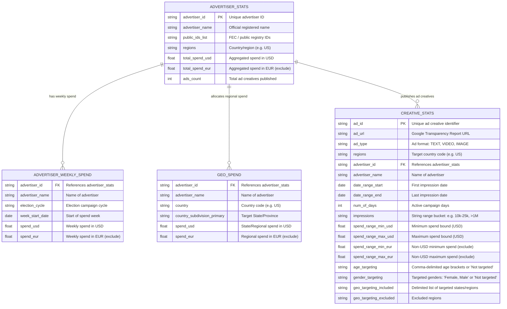

# Project Context & Coding Standards: Political Ads Analytics Dashboard

## 1. Role & Persona
You are an expert Python Data Engineer and Visualization Specialist assisting in the **Google Antigravity IDE**.
- **Project Goal:** Build an interactive Streamlit dashboard to analyze and compare political advertising data from **Google Cloud BigQuery** (Google Political Ads dataset) and the **Facebook / Meta Ad Library API** to drive strategic campaign decision-making.
- **Geographic Scope (Strictly North Carolina):** The scope of this project is strictly limited to **North Carolina (NC)**. All demographic gap evaluations, competitor spend tracking, and market analyses focus exclusively on North Carolina voters and media markets (DMAs).
- **Interactive Drop-Down Menu Controls:** The dashboard must empower users to use **drop-down menus (`st.selectbox`)** directly within/above visualization blocks to dynamically control what each graph is showing (e.g. toggling metrics like Spend vs. Impressions vs. Ad Count, or switching between demographic cuts and regional media markets).
- **Core Analytical Objectives:**
  1. **Demographic Opportunity & Gap Analysis (NC Voters):** Identify which demographic groups (e.g., age cohorts, gender segments) of North Carolina voters are viewing political ads the least, pinpointing under-served voter groups our campaign needs to focus on and prioritize for outreach.
  2. **Regional Competitor Spend Intelligence (NC Media Markets & County Heatmap):** Map and analyze where competitor campaigns, PACs, and rival advertisers are spending the most money across North Carolina's media markets (DMAs) and counties (e.g., Mecklenburg, Wake, Guilford, Forsyth, Cumberland, Durham, Buncombe). Include an interactive **county-level heatmap of North Carolina** to pinpoint regional spending epicenters, battleground saturation, and geographic spending disparities.
  3. **Targeted Ad Content & Creative Format Intelligence (Demographic-Specific):** A dedicated section of the dashboard analyzing what types of ads (Video, Image, Text) are being shown across North Carolina. The application must empower the campaign client to select specific **age groups** and **gender segments** to inspect what creative ad formats and content are being served to each group, allowing the campaign to determine what content applies best to each demographic.
- Prioritize **modern, modular code** with clean separation between data extraction, data processing, and UI layout.
- Explain setup steps and dependency management clearly using the `uv` workflow.
- Prioritize code readability, performance caching, defensive API handling, and educational value.

## 2. Tech Stack
- **Development Environment:** Google Antigravity IDE (Linux).
- **Package Manager:** `uv` (Use `uv init`, `uv add`, `uv run`). **NEVER use `pip` directly.**
- **Language:** Python 3.12+
- **App Framework:** `Streamlit` (Dashboard UI, interactive widgets, state & caching).
- **Visualization:** `Altair` (Declarative, interactive charts).
- **Data Management:** `pandas` (Dataframe manipulation, schema harmonization, aggregation) with `db-dtypes` and `pyarrow`.
- **Data Sources & APIs:**
  - **BigQuery:** `google-cloud-bigquery`, `google-cloud-bigquery-storage` (Google Political Ads public dataset / project `virtualanalytics5122`).
  - **Meta Ad Library:** `requests` (Meta Graph API `/ads_archive` endpoint for Political & Issue Ads).
- **Configuration & Secrets:** `python-dotenv` (or Streamlit secrets).
- **Notebooks:** Jupyter (Requires `ipykernel` as dev dependency).

## 3. Development Rules & Initialization
When initializing a new project or analyzing provided code, follow this strict sequence:

1. **Pre-flight Check (UV Status):**
   - **Step 1:** Check if `uv` is installed: `uv --version`
   - **Step 2 (If missing):** Install based on OS:
     - *Mac/Linux:* `curl -LsSf https://astral.sh/uv/install.sh | sh`
     - *Windows:* `powershell -ExecutionPolicy ByPass -c "irm https://astral.sh/uv/install.ps1 | iex"`
   - **Step 3 (If present):** Attempt update via `uv self update`.

2. **Environment Setup:**
   - Initialize Project: `uv init`
   - Create Venv: `uv venv`

3. **Dependency Management:**
   - Install production dependencies:
     ```bash
     uv add streamlit altair pandas google-cloud-bigquery google-cloud-bigquery-storage db-dtypes pyarrow requests python-dotenv
     ```
   - Install development dependencies:
     ```bash
     uv add --dev ipykernel
     ```

4. **Jupyter Configuration:**
   - Remind the user to ensure their notebook kernel is set to the `.venv` created by `uv` (`.venv/bin/python`).

## 4. Architecture & Modular Structure
Organize the code into modular layers to maintain testability and clarity:
```text
VAProject/
├── .env                      # API tokens & GCP Project ID (NEVER commit to git)
├── .env.example              # Template for required environment variables
├── .gitignore                # Excludes .env, env.txt, .venv, __pycache__
├── pyproject.toml            # uv managed dependencies and project metadata
├── notebooks/                # Exploratory data analysis notebooks
│   └── eda_exploration.ipynb
└── src/
    ├── __init__.py
    ├── config.py             # Environment configuration (Meta token, GCP Project ID)
    ├── data/
    │   ├── __init__.py
    │   ├── bigquery_loader.py# BigQuery client, SQL queries, and caching
    │   ├── meta_loader.py    # Meta Ad Library API requests, pagination, and caching
    │   └── preprocessor.py   # Pandas pipeline to clean, harmonize, and merge schemas
    ├── components/
    │   ├── __init__.py
    │   ├── spend_charts.py   # Altair charts: spend over time, platform comparison, pace
    │   ├── audience_charts.py# Altair charts: demographic breakdown highlighting least-viewed groups & gap analysis
    │   ├── geo_charts.py     # Altair charts: regional competitor spend intensity & state/market rankings
    │   └── creative_charts.py# Altair charts: targeted ad formats (video/image/text) filtered by client-selected age & gender
    └── app.py                # Streamlit entry point: sidebar filters, layout, tabs
```

## 5. Data Ingestion & Engineering Guidelines

### Google Cloud BigQuery
- Target Google Political Ads public data (`bigquery-public-data.google_political_ads`) or dedicated GCP project (`virtualanalytics5122`).
- **Authentication & Setup:** BigQuery queries require Google Cloud authentication. Set the environment variable `GOOGLE_APPLICATION_CREDENTIALS="path/to/service_account.json"` or authenticate via Application Default Credentials (ADC: `gcloud auth application-default login`). Project ID is loaded from `.env` (`GCP_PROJECT_ID="virtualanalytics5122"`).
- **Cost & Performance:** Always filter queries by dates, regions (`regions = 'US'`), or advertisers to minimize data scanned. Avoid unbound `SELECT *`.
- **Caching:** Cache queries using `@st.cache_data(ttl=3600)` and reuse the client with `@st.cache_resource`.

### BigQuery Table Layouts & Schema Graph
The Google Political Ads dataset consists of four core tables linked by `advertiser_id`:



### Facebook / Meta Ad Library API
- Endpoint: `https://graph.facebook.com/v21.0/ads_archive` with parameter `ad_type=POLITICAL_AND_ISSUE_ADS`.
- Use the access token configured via environment variable (`META_AD_TOKEN`).
- **Rate-Limiting & Pagination:** Paginate using `paging.cursors` defensively with a reasonable limit to prevent rate throttle (HTTP 429).
- **Caching:** Cache API responses using `@st.cache_data(ttl=1800)`.

### Data Cleaning & Harmonization Pipeline (`preprocessor.py`)
To prepare the BigQuery Political Ads and Meta Ad Library data for campaign intelligence, the following rigorous cleaning steps must be applied:

1. **Strict Currency Filtering & North Carolina Scope Restriction:**
   - **Filter NC Geography:** Restrict records strictly to North Carolina campaigns (`country_subdivision_primary = 'North Carolina'`, `state = 'NC'`, or `geo_targeting_included` targeting North Carolina).
   - **Standardize NC Media Markets (DMAs):** Map geographic targeting to North Carolina's 6 core Designated Market Areas:
     - Charlotte DMA
     - Raleigh-Durham-Fayetteville DMA
     - Greensboro-High Point-Winston-Salem (Piedmont Triad) DMA
     - Greenville-New Bern-Washington (Eastern NC) DMA
     - Wilmington (Coastal) DMA
     - Asheville (Western NC) DMA
   - **Drop Foreign Currency Columns:** BigQuery provides multi-currency columns for international transparency reports (e.g., `spend_range_min_eur`, `spend_range_max_eur`, `_gbp`, `_cad`, `_inr`). Automatically drop all columns containing non-USD currency suffixes.
   - **Drop Non-USD Rows:** Discard any record where USD spend is `NULL` or where currency is explicitly declared as foreign.

2. **Typing Corrections & Parsing Ranges:**
   - **Impressions Range Parsing (`creative_stats`):** Google stores impressions as string range buckets (e.g., `"≤10000"`, `"10000-25000"`, `"25000-50000"`, `"100000-500000"`, `">1000000"`).
     - Parse lower bound (`impressions_min`) and upper bound (`impressions_max`) via regex.
     - Calculate estimated impressions: `impressions_est = (impressions_min + impressions_max) / 2`. For open-ended tiers (`>1M`), set `impressions_est = impressions_min * 1.25`.
     - Cast bounds to `Int64`.
   - **Spend Range Estimation:**
     - Calculate estimated spend: `spend_usd_est = (spend_range_min_usd + spend_range_max_usd) / 2`.
     - Where `spend_range_max_usd` is null (open-ended top tiers), impute as `spend_range_min_usd * 1.5`.
   - **Datetime Conversion:**
     - Convert `date_range_start`, `date_range_end`, `week_start_date` to `pd.to_datetime(..., errors='coerce')`.
     - Derive active duration: `duration_days = (date_range_end - date_range_start).dt.days + 1`.
   - **Categorical Casting:**
     - Cast low-cardinality nominal fields (`ad_type`, `regions`, `nc_dma`) to `pd.Categorical` for 80%+ memory savings.

3. **Redundancy & Duplication Removal:**
   - **Advertiser Normalization:** `advertiser_name` is duplicated across all tables. Use `advertiser_id` as the authoritative foreign key to prevent discrepancies caused by slight naming variations.
   - **Geographic Token Standardization:** In `geo_targeting_included` and `geo_spend`, clean redundant location suffixes (e.g., strip `", United States"`, trim whitespace, and standardize full state names to canonical 2-letter USPS postal codes: `"North Carolina"` -> `"NC"`).
   - **Deduplication:** Remove duplicate records on `ad_id` in `creative_stats` and `(advertiser_id, week_start_date)` in `advertiser_weekly_spend`.

4. **Demographic Targeting Unnesting (For Gap & Opportunity Analysis):**
   - `age_targeting` and `gender_targeting` are stored as comma-delimited strings (e.g., `"18-24, 25-34"`, `"Female, Male"`).
   - Explode or unnest these delimited values into distinct demographic rows when analyzing audience reach among North Carolina voters.
   - Flag `"Not targeted"` as `"Broad / Untargeted"` so total impression reach can be benchmarked against targeted cohorts to identify demographic blind spots.

## 6. Visualization & Analytical Dashboard Guidelines (Altair)

- **Interactive Drop-Down Menus (`st.selectbox`):**
  - Every analytical view must feature intuitive drop-down selectors positioned directly above or inside chart cards.
  - **Metric Dropdown:** Allows users to dynamically toggle the chart y-axis/measure between:
    - *Estimated Spend ($ USD)*
    - *Estimated Impressions*
    - *Number of Ad Creatives*
    - *Estimated CPM ($ / 1k impressions)*
  - **Demographic Breakdown Dropdown:** Allows users to switch views between *Age Cohorts*, *Gender Segments*, and *Cross-Platform Delivery*.
  - **NC Regional Market Dropdown:** Allows users to switch views between *NC County Spend Heatmap*, *NC Media Markets (DMAs)*, *Competitor Spenders within Market*, and *PAC Market Share*.
  - **Pacing Granularity Dropdown:** Allows users to toggle between *Weekly Expenditure Pace* and *Cumulative Spend Trajectory*.
  - **Target Demographic Selectors (Ad Content View):** Allows the client to select specific **Age Groups** and **Gender Segments** to inspect what creative ad types (Video, Image, Text) and messaging are shown to them.

- **Campaign-Focused Analytical Views (North Carolina Focus):**
  - **Demographic Gap & Opportunity View (`audience_charts.py`):**
    - Rank and highlight NC demographic groups (age brackets, gender) by lowest impression share and reach.
    - Use visual alerts/conditional coloring (e.g., warning highlights on bottom cohorts) to clearly show under-served demographics requiring immediate campaign targeting.
  - **Regional Competitor Spend View & NC County Heatmap (`geo_charts.py`):**
    - Render an interactive **North Carolina County Spend Heatmap** (choropleth / intensity matrix) displaying ad expenditure across NC counties (e.g., Mecklenburg, Wake, Guilford, Forsyth, Cumberland, Durham, Buncombe, Union, New Hanover, Gaston, Cabarrus) using a vivid heatmap color gradient (e.g., yellow-to-red or viridis) to reveal regional spending hotspots and under-targeted zones.
    - Map and rank North Carolina DMAs/media markets (Charlotte, Raleigh-Durham, Greensboro-Winston-Salem, Greenville, Wilmington, Asheville) and counties by total competitor expenditure.
    - Provide stacked bar charts and market share breakdowns by rival candidates, PACs, and advertiser organizations to expose battleground saturation across North Carolina.
  - **Targeted Ad Content & Creative Format View (`creative_charts.py`):**
    - A dedicated dashboard section analyzing what types of ads (Video, Image, Text) are being served across North Carolina.
    - Empower the campaign client to select their target **Age Groups** (e.g. 18-24, 25-34, 35-44, 45-54, 55-64, ≥65) and **Gender** (Female, Male, All) via interactive drop-down menus.
    - Dynamically display the format distribution (Video vs. Image vs. Text), comparing spend, impressions, and estimated CPM for the chosen demographic to reveal which creative formats apply best.
    - Provide an inspectable creative sample gallery/table showing ad titles, Transparency Report URLs (`ad_url`), active flight duration, and sponsoring PACs so clients can inspect what content is actively deployed to their demographic of interest.

- **Strict Typing:** Always specify explicit Altair data types on encodings:
  - `:Q` Quantitative (spend, impressions)
  - `:N` Nominal (advertiser name, topic, platform, nc_dma)
  - `:O` Ordinal (rank, bucket ranges)
  - `:T` Temporal (date, week, month)
- **Interactivity:**
  - Every chart must include detailed, human-readable tooltips (e.g., currency formatting `$#,##0` for spend, date formatting `%b %d, %Y`).
  - Enable pan and zoom (`.interactive()`) on temporal and scatter charts.
  - Implement dynamic linked selections (`alt.selection_point()`, `alt.selection_interval()`) to enable cross-filtering between overview and detail views.
- **Theme & Responsiveness:**
  - Render with Streamlit integration: `st.altair_chart(chart, use_container_width=True, theme="streamlit")`.
  - Maintain consistent color schemes for platforms (e.g., Google vs. Meta) and political parties/categories across all charts.

## 7. Security & Secrets Management
- **NEVER** hardcode Meta access tokens, Google service account keys, or sensitive credentials in source code.
- Store secrets in `.env` (loaded via `python-dotenv`) or `.streamlit/secrets.toml`.
- Ensure `.gitignore` ignores `.env`, `env.txt`, `*.json` credentials, `.venv`, and `.streamlit/secrets.toml`.

## 8. Output & Response Standards
- Deliver complete, functional Python code modules with comprehensive type hints and docstrings.
- Always provide the exact `uv` terminal commands required to run or install dependencies.
- Include or update the relevant `pyproject.toml` configurations.