# Meta Ad Library API Data Dictionary & Architecture Guide

This document details the data structures, endpoints, logical tables, and fields accessible via the **Meta Ad Library API (Graph API v21.0)** for **Political & Issue Ads** (`ad_type=POLITICAL_AND_ISSUE_ADS`), with specific focus on campaign intelligence, demographics, spending, and creative analysis in North Carolina.

---

## 1. Executive Summary: Graph API Architecture vs. Relational SQL

Unlike Google BigQuery, which exposes structured relational tables (`creative_stats`, `geo_spend`, `advertiser_stats`, `advertiser_weekly_spend`), Meta utilizes a **REST Graph API**. 

All political advertising data is served through the primary endpoint:
```http
GET https://graph.facebook.com/v21.0/ads_archive
```

The returned payload consists of hierarchical JSON documents containing nested sub-collections. In data engineering pipelines (like our dashboard preprocessor), these nested collections are unnested into **7 normalized logical tables**:

```mermaid
erDiagram
    META_AD_FLIGHT ||--o{ META_AD_SPEND : "discloses"
    META_AD_FLIGHT ||--o{ META_DEMOGRAPHIC_DISTRIBUTION : "delivers to"
    META_AD_FLIGHT ||--o{ META_DELIVERY_BY_REGION : "distributes across"
    META_AD_FLIGHT ||--o{ META_CREATIVE_CONTENT : "displays"
    META_AD_FLIGHT ||--o{ META_IMPRESSIONS_REACH : "measures"
    META_AD_FLIGHT ||--o{ META_TARGETING_CRITERIA : "targets"

    META_AD_FLIGHT {
        string id PK "Unique Meta Ad Creative ID"
        string page_id FK "Facebook Page ID"
        string page_name "Advertiser / Page Name"
        date ad_creation_time "Creative creation timestamp"
        date ad_delivery_start_time "Flight start date"
        date ad_delivery_stop_time "Flight end date (null if active)"
        string ad_snapshot_url "Inspectable creative snapshot URL"
        array publisher_platforms "facebook, instagram, messenger, audience_network"
        array languages "Creative language codes"
    }

    META_AD_SPEND {
        string ad_id FK "References META_AD_FLIGHT"
        float lower_bound "Minimum spend bound in USD"
        float upper_bound "Maximum spend bound in USD"
        string currency "USD"
        string bylines "Paid for by FEC disclaimer / PAC sponsor"
        array beneficiary_payers "Jurisdictional funding entities"
    }

    META_DEMOGRAPHIC_DISTRIBUTION {
        string ad_id FK "References META_AD_FLIGHT"
        string age "18-24, 25-34, 35-44, 45-54, 55-64, 65+"
        string gender "female, male, unknown"
        float percentage "Empirical audience share reached (0.0 to 1.0)"
    }

    META_DELIVERY_BY_REGION {
        string ad_id FK "References META_AD_FLIGHT"
        string region "Target state / province (e.g. North Carolina)"
        float percentage "Geographic delivery share (0.0 to 1.0)"
    }

    META_CREATIVE_CONTENT {
        string ad_id FK "References META_AD_FLIGHT"
        array ad_creative_bodies "Primary text message / ad copy"
        array ad_creative_link_titles "Headline titles on link cards"
        array ad_creative_link_descriptions "Sub-headline link description text"
        array ad_creative_link_captions "Display domain (e.g. actblue.com, fb.com)"
    }

    META_IMPRESSIONS_REACH {
        string ad_id FK "References META_AD_FLIGHT"
        int lower_bound "Minimum impressions bound"
        int upper_bound "Maximum impressions bound"
        object estimated_audience_size "Eligible target voter population"
        int eu_total_reach "Jurisdiction total reach"
        int br_total_reach "Jurisdiction total reach"
    }

    META_TARGETING_CRITERIA {
        string ad_id FK "References META_AD_FLIGHT"
        string target_ages "Advertiser configured age brackets"
        string target_gender "Advertiser configured gender target"
        array target_locations "Targeted states, DMAs, or postal codes"
    }
```



---

## 2. Logical Tables & Field Specifications

### Table 1: `META_AD_FLIGHT` (Core Ad Metadata & Lifecycle)
Tracks the lifecycle, identity, and deployment platforms of the political ad creative.

| Field Name | Type | Description | Sample Value |
| :--- | :--- | :--- | :--- |
| `id` | `String` (Numeric) | Unique global identifier for the ad creative. | `"2402602633808481"` |
| `page_id` | `String` (Numeric) | Facebook Page ID of the sponsoring organization. | `"20787991568"` |
| `page_name` | `String` | Public name of the Facebook Page publishing the ad. | `"Senate Democrats"` |
| `ad_creation_time` | `Date` (ISO) | Date/time the creative was submitted in Ads Manager. | `"2024-10-24"` |
| `ad_delivery_start_time`| `Date` (ISO) | Date/time the ad flight began displaying to voters. | `"2024-10-24"` |
| `ad_delivery_stop_time` | `Date` (ISO) | Date/time the ad flight finished (`None` if active). | `"2024-10-28"` |
| `ad_snapshot_url` | `String` (URL) | Web link to preview the full rendered creative in Meta Ad Library. | `https://www.facebook.com/ads/archive/render_ad/?id=...` |
| `publisher_platforms` | `Array[String]`| Meta ecosystem placements where the ad was served. | `["facebook", "instagram"]` |
| `languages` | `Array[String]`| Detected language codes of the creative copy. | `["en"]` |

---

### Table 2: `META_AD_SPEND` (Expenditure & Campaign Disclaimers)
Captures spend ranges, currency information, and the legally required FEC/PAC disclosure bylines.

| Field Name | Type | Description | Sample Value |
| :--- | :--- | :--- | :--- |
| `spend` | `Object` | Bounded expenditure range in declared currency. | `{"lower_bound": "100", "upper_bound": "499"}` |
| `spend.lower_bound` | `Float` | Minimum USD amount spent on this ad flight. | `100.0` |
| `spend.upper_bound` | `Float` | Maximum USD amount spent on this ad flight. | `499.0` |
| `currency` | `String` (ISO) | ISO currency code for spend bounds (strictly `USD` in US ads). | `"USD"` |
| `bylines` | `String` | Legal "Paid for by" sponsor disclaimer required by election law. | `"DSCC"`, `"Carolina Forward PAC"` |
| `beneficiary_payers` | `Array[Object]`| Entity paying for and benefiting from the advertisement. | `[{"beneficiary": "...", "payer": "..."}]` |

> [!NOTE]
> Like Google BigQuery's `spend_range_min_usd` and `spend_range_max_usd`, Meta reports spend in tier buckets rather than exact cents to balance transparency with commercial sensitivity.

---

### Table 3: `META_DEMOGRAPHIC_DISTRIBUTION` (Audience Reach by Age & Gender)
**The most critical table for voter demographic analysis.** Unlike Google Political Ads (which omits gender targeting on US election ads), Meta provides empirical audience delivery percentages broken down across age cohorts and genders.

| Field Name | Type | Description | Sample Value |
| :--- | :--- | :--- | :--- |
| `demographic_distribution` | `Array[Object]` | List of demographic segment delivery weights. | *Nested Array* |
| `├── age` | `String` | Age cohort bracket. | `"18-24"`, `"25-34"`, `"35-44"`, `"45-54"`, `"55-64"`, `"65+"` |
| `├── gender` | `String` | Voter gender delivery category. | `"female"`, `"male"`, `"unknown"` |
| `└── percentage` | `Float` (String) | Share of total ad reach delivered to this cohort (`0.000` to `1.000`). | `"0.14502"` (14.5%) |

#### Sample Demographic Payload:
```json
"demographic_distribution": [
  {"percentage": "0.142857", "age": "18-24", "gender": "female"},
  {"percentage": "0.114286", "age": "18-24", "gender": "male"},
  {"percentage": "0.185714", "age": "25-34", "gender": "female"},
  {"percentage": "0.157143", "age": "25-34", "gender": "male"},
  {"percentage": "0.085714", "age": "55-64", "gender": "female"},
  {"percentage": "0.071429", "age": "65+",   "gender": "male"}
]
```

---

### Table 4: `META_DELIVERY_BY_REGION` (Geographic Allocation by State)
Tracks geographic impression distribution across states and territories.

> [!IMPORTANT]
> In Graph API v13.0+, Meta **deprecated** `region_distribution` and replaced it with **`delivery_by_region`**. Requesting `region_distribution` results in an `HTTP 400 OAuthException (code 12)`. Always use `delivery_by_region`.

| Field Name | Type | Description | Sample Value |
| :--- | :--- | :--- | :--- |
| `delivery_by_region` | `Array[Object]` | List of state-level delivery shares. | *Nested Array* |
| `├── region` | `String` | Name of the US State or Territory. | `"North Carolina"`, `"Virginia"`, `"Georgia"` |
| `└── percentage` | `Float` (String) | Share of total ad impressions delivered in this region. | `"0.8421"` (84.2% in NC) |

---

### Table 5: `META_CREATIVE_CONTENT` (Messaging, Headlines & Link Previews)
Contains the exact messaging and creative text copies deployed to voters.

| Field Name | Type | Description | Sample Value |
| :--- | :--- | :--- | :--- |
| `ad_creative_bodies` | `Array[String]` | Primary text caption/copy of the ad post. | `["Early voting is underway across North Carolina..."]` |
| `ad_creative_link_titles` | `Array[String]` | Bold headline text appearing on link preview cards. | `["Kirsten Gillibrand is calling on you"]` |
| `ad_creative_link_descriptions`| `Array[String]`| Secondary description text beneath the headline. | `["Help Democrats defend key Senate seats!"]` |
| `ad_creative_link_captions` | `Array[String]` | Destination domain / action button caption. | `["secure.actblue.com"]`, `["fb.com"]` |

---

### Table 6: `META_IMPRESSIONS_REACH` (Impression Scale & Voter Exposure)
Measures the volume of eyeballs and eligible voter audience scale.

| Field Name | Type | Description | Sample Value |
| :--- | :--- | :--- | :--- |
| `impressions` | `Object` | Bounded range of total impressions served. | `{"lower_bound": "1000", "upper_bound": "4999"}` |
| `impressions.lower_bound` | `Integer` | Minimum impressions served. | `1000` |
| `impressions.upper_bound` | `Integer` | Maximum impressions served. | `4999` |
| `estimated_audience_size` | `Object` | Estimated number of unique voters eligible to see the ad. | `{"lower_bound": "50001", "upper_bound": "100000"}` |
| `eu_total_reach` | `Integer` | Direct reach counts for applicable European jurisdictions. | `null` (US ads) |
| `br_total_reach` | `Integer` | Direct reach counts for Brazilian election oversight. | `null` (US ads) |
| `age_country_gender_reach_breakdown` | `Array[Object]` | Granular three-way cross-tabulation when available. | `[...]` |

---

### Table 7: `META_TARGETING_CRITERIA` (Advertiser Declared Targeting)
Represents the target settings configured by campaign managers inside Meta Ads Manager.

| Field Name | Type | Description | Sample Value |
| :--- | :--- | :--- | :--- |
| `target_ages` | `String` / `Array` | Configured age range targeting. | `"18-65+"` |
| `target_gender` | `String` | Configured gender targeting. | `"All"`, `"Men"`, `"Women"` |
| `target_locations` | `Array[Object]` | Geotargeting parameters (States, DMAs, Postal Codes). | `[{"name": "North Carolina", "type": "region"}]` |

---

## 3. Active vs. Deprecated Fields (Graph API v21.0 Verification)

During live diagnostics with the active token, field availability was tested against `https://graph.facebook.com/v21.0/ads_archive`:

| Field Name | Status | Status Code | Notes |
| :--- | :--- | :--- | :--- |
| `ad_creation_time` | ✅ Active | HTTP 200 | Creation timestamp |
| `ad_creative_bodies` | ✅ Active | HTTP 200 | Text messaging / copy |
| `ad_creative_link_titles` | ✅ Active | HTTP 200 | Headline cards |
| `ad_creative_link_descriptions` | ✅ Active | HTTP 200 | Headline subtext |
| `ad_creative_link_captions` | ✅ Active | HTTP 200 | Action link domain |
| `ad_delivery_start_time` | ✅ Active | HTTP 200 | Flight start date |
| `ad_delivery_stop_time` | ✅ Active | HTTP 200 | Flight stop date |
| `ad_snapshot_url` | ✅ Active | HTTP 200 | Preview URL |
| `bylines` | ✅ Active | HTTP 200 | "Paid for by" sponsor disclaimer |
| `currency` | ✅ Active | HTTP 200 | ISO currency (`USD`) |
| `demographic_distribution` | ✅ Active | HTTP 200 | Age & Gender delivery breakdown |
| `delivery_by_region` | ✅ Active | HTTP 200 | State-level delivery percentages |
| `impressions` | ✅ Active | HTTP 200 | Lower & upper impression bounds |
| `languages` | ✅ Active | HTTP 200 | Creative language codes |
| `page_id` | ✅ Active | HTTP 200 | Sponsoring Facebook Page ID |
| `page_name` | ✅ Active | HTTP 200 | Sponsoring Page Name |
| `publisher_platforms` | ✅ Active | HTTP 200 | Facebook, Instagram, Messenger, etc. |
| `spend` | ✅ Active | HTTP 200 | Lower & upper USD spend bounds |
| `target_ages` | ✅ Active | HTTP 200 | Declared age targeting |
| `target_gender` | ✅ Active | HTTP 200 | Declared gender targeting |
| `target_locations` | ✅ Active | HTTP 200 | Declared location targeting |
| `estimated_audience_size` | ✅ Active | HTTP 200 | Addressable voter universe |
| `region_distribution` | ❌ **Deprecated** | HTTP 400 | **Do not use.** Deprecated in v13.0+. Use `delivery_by_region`. |
| `potential_reach` | ❌ **Deprecated** | HTTP 400 | **Do not use.** Deprecated in v13.0+. Use `estimated_audience_size`. |

---

## 4. Meta Ad Library vs. Google BigQuery Mapping

This cross-walk illustrates how fields from the Meta Ad Library API correspond to Google Cloud BigQuery political ads tables:

| Analytical Dimension | Google Cloud BigQuery (`google_political_ads`) | Meta Ad Library API (`/ads_archive`) |
| :--- | :--- | :--- |
| **Ad Identifier** | `creative_stats.ad_id` | `id` |
| **Advertiser Identity** | `advertiser_stats.advertiser_name` | `page_name` |
| **Organization ID** | `advertiser_stats.advertiser_id` | `page_id` |
| **PAC / Sponsor Disclaimer** | `advertiser_stats.public_ids_list` (FEC IDs) | `bylines` ("Paid for by...") |
| **Spend Lower Bound** | `creative_stats.spend_range_min_usd` | `spend.lower_bound` |
| **Spend Upper Bound** | `creative_stats.spend_range_max_usd` | `spend.upper_bound` |
| **Impressions Bucket** | `creative_stats.impressions` (string range e.g. `10k-25k`) | `impressions.lower_bound`, `impressions.upper_bound` |
| **Creative Format** | `creative_stats.ad_type` (`VIDEO`, `IMAGE`, `TEXT`) | Derived from `publisher_platforms` and creative title copy |
| **Age Demographics** | `creative_stats.age_targeting` (advertiser settings) | `demographic_distribution.age` (empirical delivery) |
| **Gender Demographics** | *Not available / "Not targeted" on US political ads* | `demographic_distribution.gender` (`female`, `male`) |
| **Geographic State** | `geo_spend.country_subdivision_primary` | `delivery_by_region.region` |
| **Ad Creative Inspection** | `creative_stats.ad_url` (Transparency Report) | `ad_snapshot_url` (Ad Library Snapshot) |
| **Ad Copy / Text** | *Not stored in BigQuery tables* | `ad_creative_bodies`, `ad_creative_link_titles` |

---

## 5. Security & Authentication Requirements

Access to the Political & Issue Ads archive requires an authorized **Meta User Access Token** configured in [.env](file:///home/sergrodo/Projects/Python/VAProject/.env) (`META_USER_TOKEN`):

### Required User Token Permissions:
- `ads_management`
- `ads_read`
- `business_management`
- `pages_read_engagement`
- `pages_manage_ads`
- `leads_retrieval`

### Security Guardrails:
1. **Never Hardcode Secrets:** The access token must be loaded dynamically at runtime via environment variables and never committed to version control.
2. **Snapshot URL Sanitization:** Meta Graph API sometimes embeds `&access_token=...` in the `ad_snapshot_url` query string. [src/data/meta_loader.py](file:///home/sergrodo/Projects/Python/VAProject/src/data/meta_loader.py) automatically strips the token parameter before presenting links to the user.
3. **Defensive Fallback:** If rate limits or authorization errors occur, the pipeline gracefully falls back to the calibrated North Carolina political ads sample dataset.
